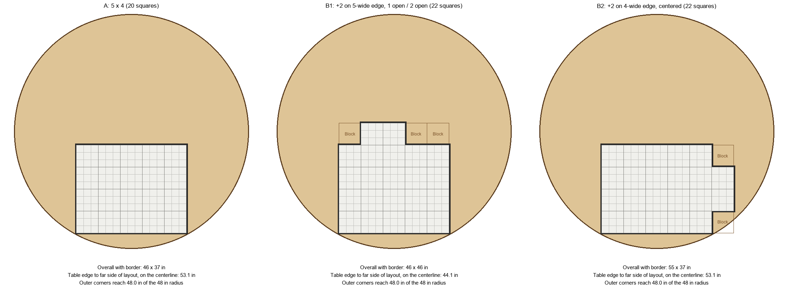
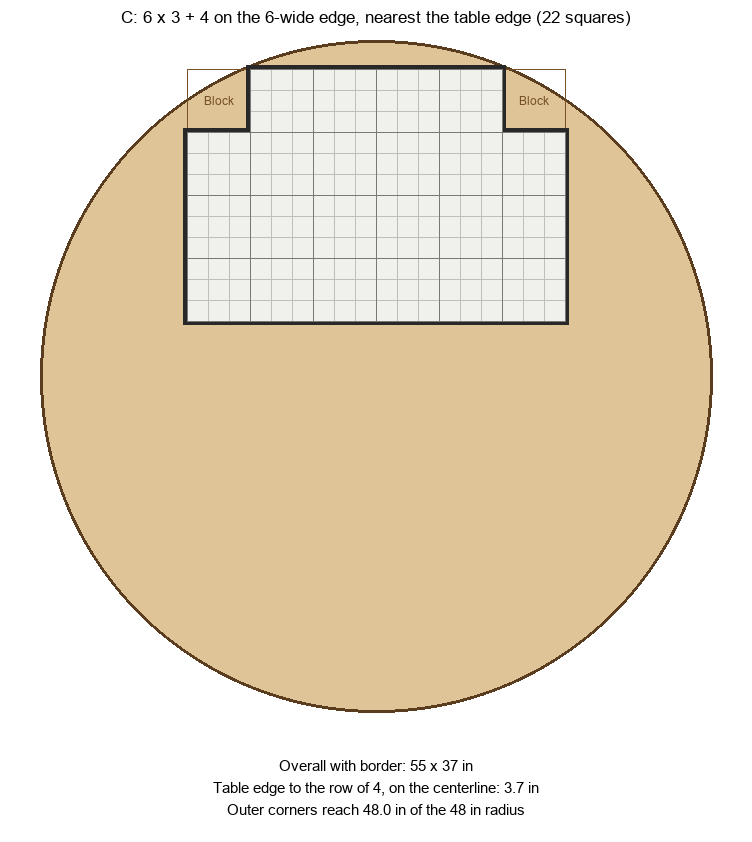

# Table Layouts — Knowledge Base

How the physical game board is laid out on a table. Not code; this is reference for
choosing and comparing field layouts. Add a new section per layout you try.

## Status

Working notes started 2026-10-22. Geometry below is computed; nothing here has been
checked against a physically assembled field yet. Items marked **TBD** need a real measurement.

## Building blocks

| Piece | Size | Notes |
|---|---|---|
| Board tile (3D printed) | 3" × 3" | One board square. The game's unit of movement |
| Field square | 9" × 9" | Holds a 3 × 3 block of tiles (9 tiles). One VEX AIM field panel |
| Field + border | — | The VEX AIM field ([248-7350](https://www.vexrobotics.com/248-7350.html)) holds the tiles in place, along with its border. Border pieces are **½" wide** (per Steve, 2026-10-22). Confirmed (Steve, 2026-10-22) to sit outside the 9" squares, so each exterior edge adds ½". Border ends are cut at 45° (per Steve, 2026-10-22), so pieces can mitre into a **concave (inside) corner** as well as a convex one. That means the stepped outline of B1/B2 can be bordered. Panels join as described under [Panel joints](#panel-joints). The VEX page returned 403 to automated fetch, so nothing else was recorded from it |
| Table | 8' (96") round | Radius 48" |

Tiles on hand: enough for **22 field squares** = 22 × 9 = **198 tiles**.

Unit conversions: 1 field square = 9" = 3 tiles per side. A layout of W × H field squares is
3W × 3H tiles and 9W" × 9H".

## Layouts

Sizes are for the field squares only, **without the border**. The ½" border adds 1" to each
bounding dimension (e.g. A is 46" × 37" with border) and moves each outer corner out by about 0.7",
so subtract up to ~0.7" from every clearance figure. "Clearance" is the distance from the
layout's farthest corner to the table edge when the layout is centered optimally on the 96" table.
Computed by minimum-enclosing-circle of the corner points (not re-run with the border; the 0.7" is
the worst case for a square outer corner).

| ID | Layout | Squares | Tiles | Size (in) | Smallest circle (in) | Clearance to table edge (in) |
|---|---|---|---|---|---|---|
| A | 5 × 4 | 20 | 15 × 12 | 45 × 36 | 57.6 | 19.2 |
| B1 | A + 2 on the 5-wide edge, 1 open square one side, 2 on the other | 22 | 15 × 15 bounding | 45 × 45 | 58.8 | 18.6 |
| B1′ | A + 2 on the 5-wide edge, flush to a corner (0 and 3 open) | 22 | 15 × 15 bounding | 45 × 45 | 63.6 | 16.2 |
| B2 | A + 2 on the 4-wide edge, centered (1 open each side) | 22 | 18 × 12 bounding | 54 × 36 | 61.2 | 17.4 |
| B2′ | A + 2 on the 4-wide edge, flush to a corner (0 and 2 open) | 22 | 18 × 12 bounding | 54 × 36 | 64.9 | 15.6 |
| C | 6 × 3 + 4 on the 6-wide edge, centered (1 open each side) | 22 | 18 × 12 bounding | 54 × 36 | 60.4 | 17.8 |

All of them fit on the table with room to spare, so the table diameter isn't the constraint.
What limits a layout is the field's own panel and border geometry (**TBD**) and where players sit.

### A — 5 × 4 (20 squares)

```
+--+--+--+--+--+
|  |  |  |  |  |
+--+--+--+--+--+
|  |  |  |  |  |     5 wide × 4 tall
+--+--+--+--+--+
|  |  |  |  |  |
+--+--+--+--+--+
|  |  |  |  |  |
+--+--+--+--+--+
```

The base case. Uses 20 of the 22 squares; 2 left over.

### B1 — 2 extra on the 5-wide edge, off-center

The two extra squares sit side by side along one 5-wide edge. They can't be centered (5 minus 2
leaves 3 open squares, which can't split evenly), so there is one open space on one side and two
on the other. Mirror image is equivalent.

```
   +--+--+
   |  |  |             one open on the left, two on the right
+--+--+--+--+--+
|  |  |  |  |  |
+--+--+--+--+--+
|  |  |  |  |  |
+--+--+--+--+--+
|  |  |  |  |  |
+--+--+--+--+--+
|  |  |  |  |  |
+--+--+--+--+--+
```

Placing the pair flush to a corner (B1′) is also possible, but leaves three open squares on
one side and sits farther out on the table (63.6" vs 58.8" circle).

### B2 — 2 extra on the 4-wide edge

The pair can be centered here (4 minus 2 leaves 2 open, 1 each side), or flush to a corner (B2′).

```
+--+--+--+--+--+
|  |  |  |  |  |
+--+--+--+--+--+--+
|  |  |  |  |  |  |
+--+--+--+--+--+--+
|  |  |  |  |  |  |
+--+--+--+--+--+--+
|  |  |  |  |  |
+--+--+--+--+--+
```

### C — 6 × 3 with 4 on the 6-wide edge (22 squares)

Three rows of 6 (18 squares) plus a row of 4 along one 6-wide edge. The 4 are centered, leaving
1 open square on each side. Bounding rectangle 6 × 4 squares, 18 × 12 tiles, with 2 Block squares
in the database.

```
   +--+--+--+--+
   |  |  |  |  |
+--+--+--+--+--+--+
|  |  |  |  |  |  |
+--+--+--+--+--+--+
|  |  |  |  |  |  |
+--+--+--+--+--+--+
|  |  |  |  |  |  |
+--+--+--+--+--+--+
```

## Layouts on the 8' table, pushed to the edge



Drawn to scale, with the ½" border. Each layout is slid toward the bottom edge until its two
bottom outer corners touch the table edge (the 5-wide body is centered left to right). Panels are
shown with their 3" tile lines; the thin outlined "Block" squares are the unused squares of the
database rectangle, not physical panels.

| Layout | Overall with border | Table edge to far side, on the centerline |
|---|---|---|
| A | 46 × 37 in | 53.1 in |
| B1 | 46 × 46 in | 44.1 in |
| B2 | 55 × 37 in | 53.1 in |

### Layout C, with the row of 4 nearest the table edge



Layout C is slid the other way: toward the edge on its row-of-4 side, until the two top outer
corners of the row of 4 touch the table edge. Overall 55 × 37 in with border. The row of 4 is 3.7 in
from the table edge on the centerline. The 6-wide body's top corners are about 3.3 in from the edge.
The bottom side leaves the most open table.

Flush-to-corner variants (B1′, B2′) are not drawn. Only the bottom corners limit how far a layout
can be pushed, so A, B1 and B2 all stop at the same distance. The B2 notch above and below the
extra pair lands in the rim region at the bottom right, which is fine because it is a Block area.

## Panel joints

From a photo of two panels interlocked along one edge (Steve, 2026-10-22; no measurements taken
from it):

- Each panel is a 3 × 3 grid of cells, each marked with grey corner brackets. That matches 9 tiles
  of 3" per panel.
- Panels join by **puzzle-style S-shaped hooks** cut into the panel edges, two per 9" edge in the
  photo. They lock panel to panel directly. There is no border piece or gap at a joint.
- The hooks stand proud of the panel on any edge that isn't joined to another panel, but there are
  never any open edges: every outer edge is covered by a ½" border (outside the 9" square), and the
  border totally covers the hooks (Steve, 2026-10-22). The hooks don't change the border fit or the
  clearance figures.
- The photo shows only a join between two panels on the same edge pair (a 2-panel strip). It does not
  show a panel joined on two sides, or an inside corner.
- Seams don't affect robot driving: the field is the base, so the robots cross the joints without
  trouble (Steve, 2026-10-22).

## Seating and database mapping

- **Seating:** The GM sits on one side of the table. Two players sit on each of the other three
  sides. The `SeatOrientation` table defines the position of each of the six (or eight) players
  (SeatID → Direction 1–4; the install script seeds 8 rows). A layout has four sides, including the
  B layouts, which use the bounding rectangle's sides.
- **Database board:** Always a full rectangle. Any square in the rectangle that has no physical
  panel uses the **Block** board element (element 44 in the install script). The stepped
  outline of B1/B2 is therefore represented as a rectangle with blocked squares. The board editor
  handles Block squares correctly (Steve, 2026-10-22).

| Layout | DB rectangle (tiles) | Field squares in it | Blocked field squares | Blocked tiles |
|---|---|---|---|---|
| A | 15 × 12 | 20 | 0 | 0 |
| B1 / B1′ | 15 × 15 | 22 | 3 | 27 |
| B2 / B2′ | 18 × 12 | 22 | 2 | 18 |

A blocked square has no panel under it, so it is also outside the physical border outline. The
blocked region is a notch in the border, which is where the 45° concave corners are used. The
concave corners work well (Steve, 2026-10-22).

## Open questions

- Which `SeatOrientation` rows to set for the GM on one side and two players per side on each
  layout. Not yet written down per layout.

## Layout log

Add dated entries as layouts are tried:

| Date | Layout | Result |
|---|---|---|
| — | — | — |
