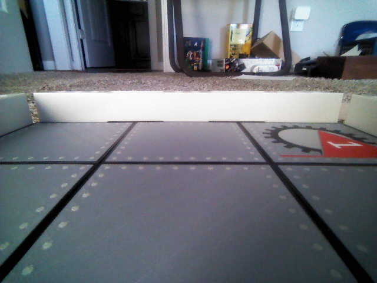

# Grid Alignment Agent

**File:** `MRR/GridAlignmentAgent.cs`
**History:** line method 2026-04-28; two-plus method 2026-10-28; **reworked 2026-10-29** for the real camera's perspective after the first frames from AIM-07.
Detection is verified on two real AIM-07 frames. **The correction loop (robot movement) has never been run** — the deployed server still has the 2026-04-28 code.

## Purpose

After each game move, a robot may drift slightly off the center of its board square. The agent captures a camera frame from the robot, finds the two "plus" intersections of the black grid lines at the **front-left and front-right corners** of the robot's square, and nudges the robot until those pluses sit where they should.

## What the Camera Sees



The AIM camera is low and looks **nearly straight ahead**, not down. So:

- The front line of the robot's square is close to horizontal, just below the middle of the frame (row ~276 of 480).
- The side lines **slant** toward the horizon (~1 px across per px down near the frame edges). They are not vertical.
- Above the front line the side lines are farther away and fade within ~25 px.
- The lower corners can contain large dark areas (shadow, floor) that are not lines.

## Architecture

```
GET /api/robot/alignthis/{robotId}   (also GET /api/robot/align/{robotId})
        ↓                            robotId is the game's RobotID, not the AIM number
GridAlignmentAgent.AlignAsync(RobotConnection)  ← main loop, up to 10 iterations
        ↓
RobotConnection.GetCameraImageAsync()           ← ws://{Hostname}:80/ws_img, one frame
        ↓
GridAlignmentAgent.FindPluses(byte[])           → PlusAnalysis
        ↓
GridAlignmentAgent.PlanMove(PlusAnalysis)       → AlignmentMove (one drive + one turn)
        ↓
drive_for (any direction), then turn_for; WaitForStopAsync after each
```

## Test Page

`http://<server>:5000/align.html`: pick a robot, press **Align**. It calls `alignthis/{RobotID}` (the robot moves), then shows the last marked-up camera image and the JSON result. The result's `imageFile` names that image; `GET /api/robot/alignimage/{imageFile}` serves it from `ImageDirectory` (bare `*_pluses.jpg` names only).

## How Detection Works

Rows above `SearchTopNorm` (40% of the height) are ignored.

1. **Front line.** Each row is scored by its *weakest* third of the image width (dark pixels summed over a ±2% band of rows). Tilts up to `MaxTiltDeg` are tried, so a rotated robot's line still scores. Requiring all three thirds means a dark blob or a slanted side line in one part of the frame can't count. The **lowest** row that qualifies is the front line, since the front corners of the robot's own square are the nearest line. A least-squares fit through it gives its exact position and tilt.
2. **Side-line crossings.** Dark runs are collected along two curves, `ArmGapNorm` above and below the fitted line. Runs wider than `MaxSideLineWidthNorm` are blobs and are dropped. Each run is followed away from the line for `ArmLengthNorm`, re-centering every row so slanted lines can be followed.
3. **Pluses.** An above run and a below run within `MaxSideLineSlope` of each other are one plus. A T or L has only one side and is rejected. The plus center is midway between them, on the fitted line.
4. **Front corners.** The nearest plus left of the image center and the nearest plus right of it.

## Target: Symmetric About Center

No calibration. The robot is aligned when:

| Error | Measured as | Target |
|---|---|---|
| Rotation | `TiltDeg` = angle of the line from left plus to right plus | 0° |
| Sideways | `LateralOffsetNorm` = plus midpoint X − 0.5 | 0 |
| Forward/back | `MidY` = plus midpoint Y | `TargetPlusHeightNorm` (0.575) |

This assumes the camera is mounted dead-center and straight. If it isn't, the robot will end up consistently off by the camera's offset.

### Rotation and position from the vanishing point (since 2026-11-01)

The two side lines are parallel on the board, so in the frame they meet at a **vanishing point** (≈ row 95–99 on AIM-04/07). It moves sideways when the robot **turns**, not when it slides. So:

- **Rotation** = vanishing point's offset from image center (`YawOffsetNorm`). Turn = offset ÷ `VanishingShiftPerTurnDeg`.
- **Sideways position** = plus midpoint minus vanishing point (`PositionOffsetNorm`). Turning moves both equally, so this is pure position.

Why: with the front line's tilt as the rotation measure, AIM-04 runs (2026-11-01, 21:49–21:54) all finished "aligned" with tilt ≈ −0.5° but the vanishing point **+12 to +39 px** (typically ~25 px, ≈1.4° turned left) and the side lines unevenly steep (left ≈ −0.93, right ≈ +0.72 = shifted right). On the board the robot was turned left and near the right edge. Tilt reads level ~1.4° off straight (likely a slight camera roll), and the code then slid the robot sideways to center a view that was off only because of the rotation.

Also measured in those runs: **every sideways drive rotated the robot** (3–4 mm right moved the vanishing point −4 to −24.5 px), and **small turns are imprecise** (4–24.5 px per commanded degree). The loop absorbs both, one frame at a time.

If the side lines can't be fitted (3 of 83 frames that night; synthetic test frames have no perspective), `PlanMove` falls back to tilt plus `LateralShiftPerTurnDeg`.

"Centered vanishing point = straight" assumes the camera faces exactly forward. Each robot's camera may differ; if one robot always ends slightly turned, it needs a per-robot offset.

The marked-up image draws the fitted side lines in yellow, from each plus up to the vanishing point.

### One correction step per frame (since 2026-11-01)

`PlanMove` turns one frame into one `AlignmentMove`: a single `drive_for` that combines sideways and forward/back (angle = `atan2(right, forward)`, 0 = forward, 90 = right, 180 = back), then a `turn_for` by `TiltDeg`. The next frame is only taken after both, so the robot never needs to see the pluses between the drive and the turn. Each error is only corrected if outside its threshold; a drive that rounds to 0 mm is never sent, because `drive_for` with distance 0 doesn't stop.

Before this, each step did only one of rotate / strafe / drive, rotating first. When the robot was close and off to one side, the rotation slid a plus out of view and alignment stopped.

**Turning slides the view sideways.** The camera looks straight ahead, so a turn pans the image. Four rotate-only steps on AIM-07 (2026-11-01, 21:29–21:30) each moved `LateralOffsetNorm` by −0.015 to −0.017 per degree of `turn_for` (e.g. turn −6.94° → lateral 0.003 → 0.115). `PlanMove` plans the sideways drive against the predicted post-turn offset, `LateralOffsetNorm + LateralShiftPerTurnDeg × turn`, so the pluses end up centered after the turn. The same steps also show each turn fixed only ~50–60% of the measured tilt; turns are not scaled up for this yet.

## Tunable Constants

| Constant | Default | What to adjust |
|---|---|---|
| `DarkFractionOfMedian` | 0.7 | A pixel is black if darker than this fraction of the search region's median brightness, so it adapts to exposure. Replaced a fixed cutoff of 60 on 2026-10-29: a brighter frame (floor ~161, lines up to ~70) failed. Swept 0.35–0.7 over all 9 real frames from that day: 0.7 found all 9; 0.5 found 3 |
| `SearchTopNorm` | 0.4 | Must stay above the front line with room for the upper arms |
| `TargetPlusHeightNorm` | 0.575 | Taken from the first AIM-07 frame, robot **not** confirmed centered. **Re-measure with a hand-centered robot** |
| `MinLineRowsPerThird` | 3.0 | Lower if a thin front line is missed |
| `MaxTiltDeg` | 10 | Tilts up to ~12° are found in practice |
| `ArmGapNorm` / `ArmLengthNorm` | 0.015 / 0.025 | Distance from the line where side lines are looked for, and how far they're followed |
| `MaxSideLineWidthNorm` | 0.08 | Raise if a near, thick side line is dropped as a blob |
| `LateralScaleMm` | 95 | mm per unit of `PositionOffsetNorm`; measured on AIM-04 from eight sideways drives (67–114) |
| `ForwardScaleMm` | 172 | mm per unit of `MidY` error; measured from thirteen backward drives (0.0058 per mm). Was 60, which made each step a third too short |
| `LateralThresholdNorm` / `ForwardThresholdNorm` | 0.02 / 0.015 | ≈ 1.9 mm / 2.6 mm. Were 0.04 (≈ 3.8 / 6.9 mm): runs backing up from too close stopped ~6 mm short |
| `VanishingShiftPerTurnDeg` | −0.029 | Vanishing-point move per degree of `turn_for` (18.6 px on 640); median of nine turns that ranged 4–24.5 px/° |
| `SideLineFitNorm` | 0.23 | How far below the pluses the side lines are followed to fit the vanishing point |
| `LateralShiftPerTurnDeg` | −0.016 | Sideways slide of the pluses per degree turned; measured, see above |

## Test Results

Unit tests: `MRR.Tests/GridAlignmentTests.cs` (`dotnet test MRR.Tests --filter GridAlignmentTests`).

| Case | Result |
|---|---|
| Real AIM-07 frame (`TestData/grid_align_aim07_20261029.jpg`) | Found, within 1.5% of hand-measured plus positions (168, 276) and (461, 276) |
| Second real AIM-07 frame (robot since moved; not in the tests) | Found, crosses on the pluses, tilt −1.5° |
| Bright real AIM-07 frame (`TestData/grid_align_aim07_bright_20261029.jpg`) | Found, within 1.5% of hand-measured (197, 285) and (506, 285) |
| Synthetic: centered, shifted, noisy | Found, exact |
| Synthetic: rotated ±2°, ±5°, ±10° (and 3–12° in a probe) | Found, tilt within 0.02° |
| Synthetic: rotated 15° | Not found (beyond `MaxTiltDeg`) |
| T junctions only, no lines, not an image | Correctly not found |

## Debug Images

Each iteration saves `align_{host}_{ts}_orig.jpg` and `..._pluses.jpg` (dark pixels red, ignored region grayed, found pluses drawn green) to `GridAlignment:ImageDirectory` in `MRR/appsettings.json` — **`/home/mrr/images/align/`**. `RobotConnection.GetCameraImageAsync` also saves every raw frame there as `align_{host}_{ts}.jpg`. If the setting is missing, both fall back to `images/align` under the working directory (`/srv/mrr/game` under systemd). Images saved before 2026-10-29's change are in `/srv/mrr/game/images/align/`.

## Known Unknowns

- Directions on AIM-07 (2026-10-29): **strafe correct** (lateral 0.056 → 0.020 in one step). **Rotation was reversed** (tilt −8.2° → turned +8.2° → −10.3°) and is now `turn_for angle = TiltDeg`; the fixed sign is not yet re-tested. Forward/back not yet exercised.
- Rotation gain: an 8° turn changed the measured tilt by only ~2°, because the forward-looking camera sees robot yaw mostly as a sideways pan, not as line tilt. If that holds, each turn under-corrects (safe, but slow), and the 1° tilt threshold allows several degrees of real yaw. The symmetry of the two side lines (where they converge) may be a better yaw measure.
- `TargetPlusHeightNorm` and the mm scales need a hand-centered robot and a few live runs.
- Lighting: only one room's lighting has been seen. The faint upper arms are the first thing to fail if it gets darker.
- `ws_img` frame format is confirmed; streaming behavior and frame rate are not. See `ws_img_format.md`.
