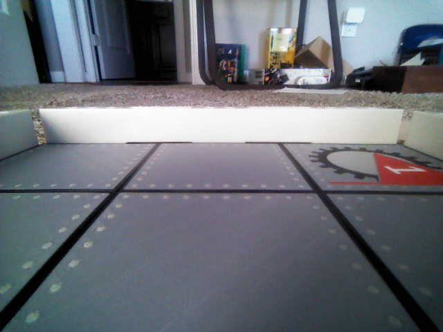

# Grid Alignment Agent

**File:** `MRR/GridAlignmentAgent.cs`
**History:** line method 2026-04-28; two-plus method 2026-10-28; **reworked 2026-10-29** for the real camera's perspective after the first frames from AIM-07.
Detection is verified on two real AIM-07 frames. **The correction loop (robot movement) has never been run** — the deployed server still has the 2026-04-28 code.

## Purpose

After each game move, a robot may drift slightly off the center of its board square. The agent captures a camera frame from the robot, finds the two "plus" intersections of the black grid lines at the **front-left and front-right corners** of the robot's square, and nudges the robot until those pluses sit where they should.

## What the Camera Sees



The AIM camera is low and looks **nearly straight ahead**, not down. So:

- The front line of the robot's square is close to horizontal, just below the middle of the frame (row ~276 of 480).
- The side lines **slant** toward the horizon (~1 px across per px down near the frame edges). They are not vertical.
- Above the front line the side lines are farther away and fade within ~25 px.
- The lower corners can contain large dark areas (shadow, floor) that are not lines.

## Architecture

```
GET /api/robot/alignthis/{robotId}   (also GET /api/robot/align/{robotId})
        ↓                            robotId is the game's RobotID, not the AIM number
GridAlignmentAgent.AlignAsync(RobotConnection)  ← main loop, up to 10 iterations
        ↓
RobotConnection.GetCameraImageAsync()           ← ws://{Hostname}:80/ws_img, one frame
        ↓
GridAlignmentAgent.FindPluses(byte[])           → PlusAnalysis
        ↓
turn_for / drive_for nudge + WaitForStopAsync
```

## How Detection Works

Rows above `SearchTopNorm` (40% of the height) are ignored.

1. **Front line.** Each row is scored by its *weakest* third of the image width (dark pixels summed over a ±2% band of rows). Tilts up to `MaxTiltDeg` are tried, so a rotated robot's line still scores. Requiring all three thirds means a dark blob or a slanted side line in one part of the frame can't count. The **lowest** row that qualifies is the front line, since the front corners of the robot's own square are the nearest line. A least-squares fit through it gives its exact position and tilt.
2. **Side-line crossings.** Dark runs are collected along two curves, `ArmGapNorm` above and below the fitted line. Runs wider than `MaxSideLineWidthNorm` are blobs and are dropped. Each run is followed away from the line for `ArmLengthNorm`, re-centering every row so slanted lines can be followed.
3. **Pluses.** An above run and a below run within `MaxSideLineSlope` of each other are one plus. A T or L has only one side and is rejected. The plus center is midway between them, on the fitted line.
4. **Front corners.** The nearest plus left of the image center and the nearest plus right of it.

## Target: Symmetric About Center

No calibration. The robot is aligned when:

| Correction (in this order) | Measured as | Target |
|---|---|---|
| 1. Rotate (`turn_for`) | `TiltDeg` = angle of the line from left plus to right plus | 0° |
| 2. Strafe (`drive_for` ±90°) | `LateralOffsetNorm` = plus midpoint X − 0.5 | 0 |
| 3. Forward/back (`drive_for` 0°/180°) | `MidY` = plus midpoint Y | `TargetPlusHeightNorm` (0.575) |

This assumes the camera is mounted dead-center and straight. If it isn't, the robot will end up consistently off by the camera's offset.

## Tunable Constants

| Constant | Default | What to adjust |
|---|---|---|
| `DarkFractionOfMedian` | 0.7 | A pixel is black if darker than this fraction of the search region's median brightness, so it adapts to exposure. Replaced a fixed cutoff of 60 on 2026-10-29: a brighter frame (floor ~161, lines up to ~70) failed. Swept 0.35–0.7 over all 9 real frames from that day: 0.7 found all 9; 0.5 found 3 |
| `SearchTopNorm` | 0.4 | Must stay above the front line with room for the upper arms |
| `TargetPlusHeightNorm` | 0.575 | Taken from the first AIM-07 frame, robot **not** confirmed centered. **Re-measure with a hand-centered robot** |
| `MinLineRowsPerThird` | 3.0 | Lower if a thin front line is missed |
| `MaxTiltDeg` | 10 | Tilts up to ~12° are found in practice |
| `ArmGapNorm` / `ArmLengthNorm` | 0.015 / 0.025 | Distance from the line where side lines are looked for, and how far they're followed |
| `MaxSideLineWidthNorm` | 0.08 | Raise if a near, thick side line is dropped as a blob |
| `LateralScaleMm` / `ForwardScaleMm` | 60 | mm moved per unit of normalized offset — not yet tuned |

## Test Results

Unit tests: `MRR.Tests/GridAlignmentTests.cs` (`dotnet test MRR.Tests --filter GridAlignmentTests`).

| Case | Result |
|---|---|
| Real AIM-07 frame (`TestData/grid_align_aim07_20261029.jpg`) | Found, within 1.5% of hand-measured plus positions (168, 276) and (461, 276) |
| Second real AIM-07 frame (robot since moved; not in the tests) | Found, crosses on the pluses, tilt −1.5° |
| Bright real AIM-07 frame (`TestData/grid_align_aim07_bright_20261029.jpg`) | Found, within 1.5% of hand-measured (197, 285) and (506, 285) |
| Synthetic: centered, shifted, noisy | Found, exact |
| Synthetic: rotated ±2°, ±5°, ±10° (and 3–12° in a probe) | Found, tilt within 0.02° |
| Synthetic: rotated 15° | Not found (beyond `MaxTiltDeg`) |
| T junctions only, no lines, not an image | Correctly not found |

## Debug Images

Each iteration saves `align_{host}_{ts}_orig.jpg` and `..._pluses.jpg` (dark pixels red, ignored region grayed, found pluses drawn green) to `GridAlignment:ImageDirectory` in `MRR/appsettings.json` — **`/home/mrr/images/align/`**. `RobotConnection.GetCameraImageAsync` also saves every raw frame there as `align_{host}_{ts}.jpg`. If the setting is missing, both fall back to `images/align` under the working directory (`/srv/mrr/game` under systemd). Images saved before 2026-10-29's change are in `/srv/mrr/game/images/align/`.

## Known Unknowns

- Directions on AIM-07 (2026-10-29): **strafe correct** (lateral 0.056 → 0.020 in one step). **Rotation was reversed** (tilt −8.2° → turned +8.2° → −10.3°) and is now `turn_for angle = TiltDeg`; the fixed sign is not yet re-tested. Forward/back not yet exercised.
- Rotation gain: an 8° turn changed the measured tilt by only ~2°, because the forward-looking camera sees robot yaw mostly as a sideways pan, not as line tilt. If that holds, each turn under-corrects (safe, but slow), and the 1° tilt threshold allows several degrees of real yaw. The symmetry of the two side lines (where they converge) may be a better yaw measure.
- `TargetPlusHeightNorm` and the mm scales need a hand-centered robot and a few live runs.
- Lighting: only one room's lighting has been seen. The faint upper arms are the first thing to fail if it gets darker.
- `ws_img` frame format is confirmed; streaming behavior and frame rate are not. See `ws_img_format.md`.
